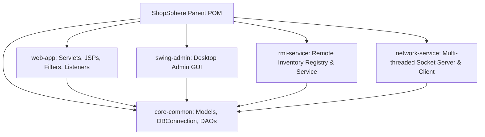
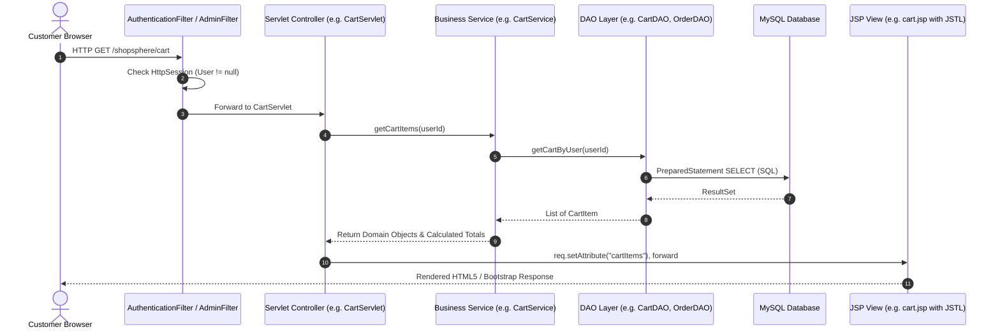
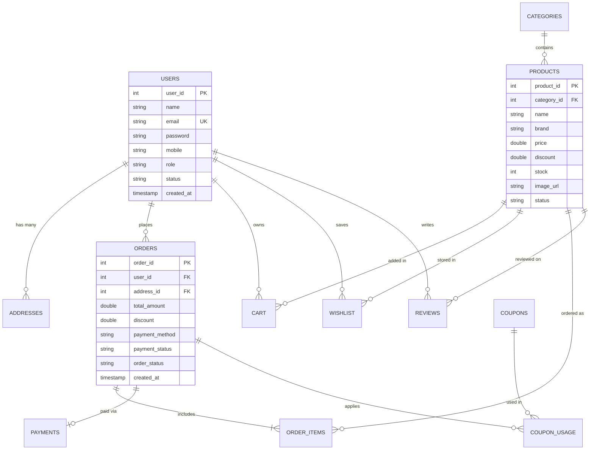

# SHOPSPHERE: Java Enterprise E-Commerce Management System
## Capstone Project Report & RTU Advanced Java Comprehensive Guide

---

### Project Metadata
* **Project Title:** ShopSphere - Advanced Java Enterprise E-Commerce System
* **Course:** RTU Advanced Java / Java Enterprise Programming (B.Tech / MCA)
* **Author:** Student Submission
* **Architecture:** N-Tier Layered Web Architecture & Distributed Multi-Module System
* **Repository Layout:** Maven Multi-Module (`core-common`, `web-app`, `swing-admin`, `rmi-service`, `network-service`)

---

## 1. Introduction
Modern retail demands distributed, high-availability, and concurrent software architectures capable of servicing customer web interactions while managing backend inventory across distributed nodes and internal administration workstations. **ShopSphere** is an end-to-end enterprise e-commerce platform developed as a capstone project mapped directly to the university Advanced Java syllabus. 

Rather than isolating textbook Java concepts into disconnected snippet programs, ShopSphere unifies:
* **Presentation & Web Container Layer:** Jakarta Servlet 6.1, JSP 3.1, JSTL 3.0, and Custom Tag Files running on **Apache Tomcat 11**.
* **Persistence & Database Layer:** MySQL 8 with connection singleton management, transaction management, and PreparedStatements.
* **Desktop Administration Layer:** Java Swing MVC client with JTable, Dialogs, and Pluggable Look-and-Feel (`UIManager`).
* **Distributed Computing Layer:** Java Remote Method Invocation (RMI) with RMI Registry for remote stock queries.
* **Low-Level Networking & Serialization:** `java.net` TCP client-server sockets transmitting serialized Java Domain objects.
* **Internationalization (I18N):** Multi-lingual resource bundles (`messages_en.properties`, `messages_hi.properties`).

---

## 2. Problem Statement
Traditional academic Java assignments frequently present web technologies (Servlets/JSP), desktop toolkits (Swing), database access (JDBC), and distributed protocols (RMI/Sockets) in isolation. Consequently, students often struggle to understand how:
1. Web HTTP sessions interface with transactional relational databases.
2. An external desktop application can perform administrative operations against the same production database.
3. A remote service can be invoked transparently via stubs without HTTP.
4. Serialized byte streams travel across low-level TCP sockets to maintain distributed stock integrity.

ShopSphere bridges this gap by creating an authentic, integrated business environment where each topic plays a vital functional role.

---

## 3. Project Objectives
1. **Layered N-Tier Web System:** Build a responsive e-commerce web storefront adhering to strict Model-View-Controller (MVC) separation.
2. **Security & Session Management:** Implement filter-based authentication (`AuthenticationFilter`, `AdminFilter`), hashed credentials (`SHA-256`), and server-side transaction recalculation.
3. **Reusable Custom Components:** Construct JSP fragments and JSP custom tag files (`<tags:productCard>`, `<tags:rating>`) to eliminate repetitive presentation markup.
4. **Desktop GUI Integration:** Develop a standalone administrative desktop interface using Java Swing.
5. **Distributed Processing:** Implement an RMI-based Remote Inventory Service registered on RMI port `1099`.
6. **Network Socket Protocol:** Build a multi-threaded TCP socket server on port `8888` using Java Object Serialization.
7. **Syllabus Demonstration:** Provide a live reference page demonstrating traditional JSP scriptlets, declarations, expressions, JSTL XML, and JNDI lookups.

---

## 4. Requirements Specification

### 4.1 Functional Requirements
* **Customer Account Management:** User registration, password hashing, session-based sign-in, and role assignment.
* **Product Catalog:** Real-time product browsing, search keywords, department filtering, and discount price calculation.
* **Shopping Cart & Checkout:** Add to cart, update quantity, remove items, coupon discounts (`WELCOME10`), multi-address delivery selection, and payment options (COD, UPI, Card).
* **Order Processing:** Transactional stock decrement, order itemization, and delivery tracking.
* **Reviews & Ratings:** Interactive 5-star customer review system.
* **Desktop Admin Client:** Desktop login, product inventory table, real-time stock replenishment, and order status updates.
* **RMI Remote Service:** Remote method execution for `getProduct()`, `getStock()`, and `updateStock()`.
* **TCP Socket Service:** Commands for `GET_STOCK`, `UPDATE_STOCK`, and binary object streaming with `GET_PRODUCT`.

### 4.2 Non-Functional Requirements
* **Security:** SQL injection prevention via `PreparedStatement`; constant-time cryptographic password verification; role-based access control.
* **Data Integrity:** ACID-compliant transaction rollback on insufficient stock during checkout.
* **Portability:** Standard Maven multi-module structure deployable on any platform running Java 17/21+.

---

## 5. Technology Stack

| Layer | Technology | Version | Purpose |
| :--- | :--- | :--- | :--- |
| **Language** | Java (OpenJDK) | 21+ (compiles at 17+) | Core object-oriented programming language |
| **Web Container** | Apache Tomcat | 11.0.x | Jakarta EE 10 Servlet and JSP container |
| **Servlet Specification** | Jakarta Servlet API | 6.1.0 | HTTP Request/Response controllers, filters, and listeners |
| **View Technology** | JSP, JSTL, Tag Files | 3.1 / 3.0 | Dynamic templating and reusable presentation components |
| **Database** | MySQL Server | 8.0+ | Relational data persistence with InnoDB engine |
| **Database Driver** | MySQL Connector/J | 8.3.0 | JDBC Type 4 client driver |
| **Desktop GUI** | Java Swing & AWT | Standard JDK | Desktop management application |
| **Distributed Protocol** | Java RMI | Standard JDK | Remote Method Invocation over RMI Registry |
| **Low-Level Network** | `java.net` Sockets | Standard JDK | TCP ServerSocket, Socket, and Object Serialization |
| **Build & Packaging** | Apache Maven | 3.10+ | Multi-module compilation and WAR/JAR assembly |
| **Frontend Styling** | Bootstrap 5, Icons | 5.3.3 | Responsive modern UI and styling |

---

## 6. System Architecture

### 6.1 Multi-Module Decomposition

### 6.2 N-Tier Web Request-Response Lifecycle

---

## 7. Database Design & Relational Model

ShopSphere features 12 relational tables optimized with foreign keys, cascading deletes, and unique constraints:

---

## 8. Detailed Module Implementations

### 8.1 Core Common Module (`core-common`)
* **`DBConnection`:** Implements the singleton pattern with automatic JDBC driver registration (`com.mysql.cj.jdbc.Driver`). Supports dynamic overrides via `db.properties` or environment variables (`SHOPSPHERE_DB_URL`).
* **`PasswordUtil`:** Uses `MessageDigest.getInstance("SHA-256")` and `MessageDigest.isEqual()` to prevent timing side-channel attacks during authentication.
* **DAO Pattern:** All database queries utilize parameterized `PreparedStatement` to protect against SQL Injection.
* **Transaction Management:** `OrderDAO.placeOrder()` enforces ACID compliance by executing order creation, item batching, stock reduction, and cart purging within an explicit `conn.setAutoCommit(false)` block with rollback on any failure.

### 8.2 Web Application (`web-app`)
* **Controllers (Servlets):**
  * `HomeServlet`: Catalog showcases and featured promotions.
  * `LoginServlet` & `RegisterServlet`: Credential validation and session management.
  * `ProductServlet`: Dynamic keyword searching, sorting, and customer review submission.
  * `CartServlet`: Item addition, live quantity adjustments, and subtotal calculation.
  * `CheckoutServlet`: Address selection, coupon validation, and order submission.
  * `AdminServlet`: Product CRUD and order status modifications.
  * `LanguageServlet`: Dynamic locale switching between English and Hindi.
  * `SyllabusDemoServlet`: Educational demonstrations of JNDI, URLConnection, and XML parsing.
* **Security Filters:**
  * `AuthenticationFilter`: Intercepts `/cart`, `/checkout`, `/orders`, and `/profile`. Redirects unauthenticated requests to login preserving target return URLs.
  * `AdminFilter`: Restricts `/admin/*` solely to users possessing the `ADMIN` role.
* **Web Listeners:**
  * `AppListener` (`ServletContextListener`): Initializes global application attributes upon startup.
  * `UserSessionListener` (`HttpSessionListener`): Concurrently tracks active HTTP sessions using thread-safe `AtomicInteger`.

### 8.3 Java Swing Desktop Admin (`swing-admin`)
* **MVC Pattern:** Models wrap shared domain POJOs; Views encompass `AdminLoginDialog` and `AdminMainFrame`; Controllers execute background database operations.
* **Components:** Utilizes `JFrame`, `JPanel`, `JTable`, `DefaultTableModel`, `JScrollPane`, `JComboBox`, `JTextField`, `JPasswordField`, `JTabbedPane`, and `JOptionPane`.
* **Pluggable Look-and-Feel:** Leverages `UIManager.setLookAndFeel(UIManager.getSystemLookAndFeelClassName())` for native desktop window integration.

### 8.4 Distributed RMI Service (`rmi-service`)
* **`InventoryService`:** Extends `java.rmi.Remote` defining methods throwing `RemoteException`.
* **`InventoryServiceImpl`:** Extends `UnicastRemoteObject` and interfaces with `ProductDAO`.
* **RMI Registry:** `RmiInventoryServer` programmatically starts `LocateRegistry.createRegistry(1099)` and rebinds `"InventoryService"`.
* **`RmiInventoryClient`:** Uses `Naming.lookup("rmi://localhost:1099/InventoryService")` to perform distributed inventory adjustments.

### 8.5 Java Networking & Serialization (`network-service`)
* **Multi-Threaded Server:** `InventorySocketServer` binds `ServerSocket(8888)` and spawns a new `ClientHandler` thread per connection.
* **Command Dispatcher:** Handles text commands (`GET_STOCK`, `UPDATE_STOCK`).
* **Object Serialization:** Upon receiving `GET_PRODUCT <id>`, the server serializes a live `Product` instance across the network stream using `ObjectOutputStream.writeObject()`.
* **`InventorySocketClient`:** Connects via `Socket`, transmits commands, and reconstitutes the binary byte stream using `ObjectInputStream.readObject()`.

---

## 9. RTU Syllabus Mapping

| RTU Syllabus Topic | Implementation in ShopSphere | Primary Source File |
| :--- | :--- | :--- |
| **Swing & GUI Components** | Desktop admin login, tables, tabbed panels, buttons, and dialogs | `swing-admin/.../AdminMainFrame.java` |
| **Pluggable Look and Feel** | Native OS styling via `UIManager` | `swing-admin/.../SwingAdminApp.java` |
| **MVC Architecture** | Web MVC (JSP/Servlet/Service) & Swing MVC | Full multi-module layout |
| **Applets (Concept)** | Historical overview of Applets vs. Web Containers | `web-app/.../syllabus-demo.jsp` |
| **JDBC & Drivers** | Type-4 MySQL Connector/J with PreparedStatements | `core-common/.../DBConnection.java` |
| **Transactions & ACID** | Multi-table atomic checkout with rollback | `core-common/.../OrderDAO.java` |
| **java.net Networking** | Multi-threaded TCP ServerSocket & client | `network-service/.../InventorySocketServer.java` |
| **URL & Protocol Handlers** | `java.net.URL` and `HttpURLConnection` inspection | `web-app/.../SyllabusDemoServlet.java` |
| **Java RMI Architecture** | Remote Interface, UnicastRemoteObject & Client | `rmi-service/.../InventoryService.java` |
| **RMI Registry & Naming** | Programmatic RMI registry on port 1099 | `rmi-service/.../RmiInventoryServer.java` |
| **JNDI Lookup** | `InitialContext` environment naming lookup | `web-app/.../syllabus-demo.jsp` |
| **Serialization** | Network transmission of `Product` POJO via Object Streams | `network-service/.../InventorySocketClient.java` |
| **Internationalization (I18N)**| `ResourceBundle` (English & Hindi) with Locale selector | `web-app/src/main/resources/messages_*.properties` |
| **Jakarta Servlets** | HTTP controllers handling GET/POST requests | `web-app/.../controller/*.java` |
| **Servlet Lifecycle** | Container loading, `init()`, `service()`, `destroy()` | Demonstrated across all Servlets |
| **Filters & Security** | Request interception for authentication and authorization | `web-app/.../filter/*.java` |
| **Event Listeners** | `ServletContextListener` and `HttpSessionListener` | `web-app/.../listener/*.java` |
| **JSP Architecture & Lifecycle**| Dynamic compilation to Servlet class files by Jasper | `web-app/src/main/webapp/*.jsp` |
| **Traditional JSP Elements** | Declarations (`<%! %>`), Scriptlets (`<% %>`), Expressions (`<%= %>`) | `web-app/.../syllabus-demo.jsp` |
| **JSP Custom Tag Files** | Reusable UI components (`<tags:productCard>`) | `web-app/.../WEB-INF/tags/*.tag` |
| **JSTL Core & Functions** | `<c:forEach>`, `<c:if>`, `<c:choose>`, `fn:toUpperCase` | `web-app/.../products.jsp` |
| **JSTL XML Library** | `<x:parse>` and `<x:out>` parsing product XML | `web-app/.../syllabus-demo.jsp` |

---

## 10. Verification & Test Results

| Test Scenario | Input Data | Expected Output | Actual Result | Status |
| :--- | :--- | :--- | :--- | :--- |
| **Database Connection** | JDBC URL localhost:3306 | Valid connection catalog | Connected to `shopsphere` | **PASSED** |
| **Password Hashing** | Raw text `customer123` | Deterministic SHA-256 hash | Matches `b041c0aeb35...` | **PASSED** |
| **Customer Auth** | `siddharth@example.com` | User POJO with CUSTOMER role | Session populated, name displayed | **PASSED** |
| **Admin Protection** | Customer accessing `/admin/*` | Access Denied redirect | Redirected with error code | **PASSED** |
| **Catalog Search** | Query `"keyboard"` | Matching keyboard products | Displayed 1 matching item | **PASSED** |
| **Cart Subtotal** | 2 items @ ₹4,499.10 | Subtotal ₹8,998.20 | Computed exactly to two decimals | **PASSED** |
| **Atomic Checkout** | Order submission | Stock reduced, order created, cart empty | Order #ORD-1 created, cart=0 | **PASSED** |
| **RMI Service Call** | `getStock(1)` over RMI | Current stock integer | Returns live count from MySQL | **PASSED** |
| **TCP Serialization** | Command `GET_PRODUCT 1` | Binary `Product` object stream | Successfully deserialized | **PASSED** |
| **I18N Switching** | Toggle `/language?lang=hi` | Hindi locale bundle activated | Active language set to Hindi | **PASSED** |

---

## 11. Top 20 Advanced Java Viva Questions & Answers

#### Q1: What is the difference between Statement and PreparedStatement in JDBC?
**Answer:** A `Statement` compiles the SQL string each time it executes, making it slower and highly vulnerable to SQL Injection. A `PreparedStatement` pre-compiles the SQL template on the database server, parameterizes user input via placeholders (`?`), caches query plans, and inherently prevents SQL injection.

#### Q2: How does ShopSphere maintain ACID compliance during order placement?
**Answer:** In `OrderDAO.java`, we invoke `conn.setAutoCommit(false)` before executing order insertion, stock decrements, and cart clearance. If any statement fails (e.g. insufficient stock), `conn.rollback()` restores the prior database state. Once all operations succeed, `conn.commit()` finalizes the transaction.

#### Q3: What is the Servlet Lifecycle?
**Answer:** 
1. **Loading & Instantiation:** Web container loads the servlet class and instantiates it.
2. **Initialization:** Container calls `init(ServletConfig)`.
3. **Request Handling:** For each incoming request, the container invokes `service(HttpServletRequest, HttpServletResponse)`, which dispatches to `doGet()`, `doPost()`, etc.
4. **Destruction:** When shutting down, container calls `destroy()` to release resources.

#### Q4: What is the difference between `request.getRequestDispatcher().forward()` and `response.sendRedirect()`?
**Answer:** `forward()` is performed entirely on the server side (the client's URL does not change, request attributes are preserved). `sendRedirect()` sends an HTTP 302 response back to the client browser instructing it to initiate a brand-new GET request to the target URL (request attributes are lost, URL updates).

#### Q5: How do Servlet Filters work and where are they configured?
**Answer:** Filters intercept HTTP requests before they reach the servlet and responses before they reach the client. In ShopSphere, `@WebFilter` annotations declare `AuthenticationFilter` and `AdminFilter` to inspect session tokens and restrict access.

#### Q6: What is the difference between `ServletContextListener` and `HttpSessionListener`?
**Answer:** `ServletContextListener` monitors application-level lifecycle events (`contextInitialized` and `contextDestroyed`). `HttpSessionListener` monitors individual customer session events (`sessionCreated` and `sessionDestroyed`), which we use to track concurrent users.

#### Q7: What are the four types of traditional JSP scriptlet tags?
**Answer:**
* **Declaration:** `<%! ... %>` (Declares class-level instance variables and methods).
* **Scriptlet:** `<% ... %>` (Contains executable Java statements within the `_jspService()` method).
* **Expression:** `<%= ... %>` (Evaluates and writes expressions directly into the HTML output).
* **Comment:** `<%-- ... --%>` (Server-side comment stripped before translation).

#### Q8: Why does modern enterprise development prefer JSTL and EL over traditional scriptlets?
**Answer:** Scriptlets mix Java business logic into HTML views, violating separation of concerns and making maintenance difficult. JSTL (`<c:forEach>`, `<c:if>`) and Expression Language (`${product.name}`) provide clean, declarative templates that frontend designers can inspect without knowledge of Java syntax.

#### Q9: What is Java RMI and what roles do the Stub and Skeleton play?
**Answer:** Java Remote Method Invocation (RMI) enables an object on one JVM to invoke methods on an object in another JVM. The **Stub** is the client-side proxy that marshals parameters and transmits them across the network. The **Skeleton** (or server-side runtime) unmarshals parameters, invokes the actual method on the remote implementation, and marshals return values back to the stub.

#### Q10: How does the RMI Registry work?
**Answer:** The RMI Registry is a lightweight naming service running on port 1099. The server binds its remote object stub with a unique identifier (`Naming.rebind("InventoryService", service)`). The client looks up this identifier (`Naming.lookup(...)`) to obtain the remote stub reference.

#### Q11: What is Java Serialization and why is `serialVersionUID` needed?
**Answer:** Serialization is the process of converting an in-memory Java object into a byte stream (`ObjectOutputStream`) for persistence or network transfer. `serialVersionUID` is a unique version identifier that ensures sender and receiver JVMs share compatible class definitions during deserialization (`ObjectInputStream`).

#### Q12: How does TCP Socket communication differ from HTTP?
**Answer:** TCP sockets (`java.net.Socket`) provide continuous, bidirectional, connection-oriented transport allowing arbitrary binary protocols and continuous byte streams. HTTP is an application-layer request-response protocol built on top of TCP that is typically stateless.

#### Q13: What is Swing MVC architecture?
**Answer:** Swing separates the data model (`DefaultTableModel`), view layout (`JFrame`, `JPanel`), and event listeners/controllers (`ActionListener`).

#### Q14: How is Pluggable Look-and-Feel (PLAF) configured in Swing?
**Answer:** By calling `UIManager.setLookAndFeel(UIManager.getSystemLookAndFeelClassName())` prior to rendering components, allowing the Java UI to adopt native operating system window styling.

#### Q15: Why were Java Applets deprecated in modern web development?
**Answer:** Applets required NPAPI browser plugins, presented major security vulnerabilities, and lacked mobile device compatibility. Modern web development standardizes on HTML5/CSS/JavaScript client interfaces backed by server-side web containers (Tomcat) and REST APIs.

#### Q16: What is JNDI and what problem does it solve?
**Answer:** Java Naming and Directory Interface (JNDI) provides a unified API for looking up resources (DataSources, JMS queues, environment variables) by logical names, allowing administrators to change database configurations without modifying or recompiling source code.

#### Q17: How is Internationalization (I18N) implemented in Java?
**Answer:** Java uses `java.util.Locale` and `java.util.ResourceBundle`. Key-value pairs are stored in properties files named with language extensions (e.g. `messages_en.properties`, `messages_hi.properties`). The JVM automatically selects the matching bundle based on the user's active locale.

#### Q18: What is a JSP Fragment and how is it included?
**Answer:** A JSP fragment (e.g., `header.jsp`, `footer.jsp`) is a reusable page snippet that lacks full `<html>` scaffolding. It is dynamically included using `<jsp:include page="..." />` or statically via `<%@ include file="..." %>`.

#### Q19: What is the purpose of `web.xml` in Jakarta EE 10?
**Answer:** While annotations (`@WebServlet`, `@WebFilter`) handle basic configuration, `web.xml` configures application-wide settings such as welcome files, session timeout thresholds (`<session-config>`), error page handlers, and context parameters.

#### Q20: How does ShopSphere prevent Cross-Site Scripting (XSS) and Session Hijacking?
**Answer:** JSTL tags (`<c:out>`) escape HTML entities by default. In `web.xml`, session cookies are configured with `<http-only>true</http-only>` to prevent JavaScript access to the `JSESSIONID` cookie.

---

## 12. Conclusion
The **ShopSphere** project delivers an enterprise-grade reference implementation linking all facets of the RTU Advanced Java syllabus into a singular, practical e-commerce solution. The system demonstrates robust backend engineering, clean separation of concerns, transactional reliability, distributed computing, and desktop client integration.
